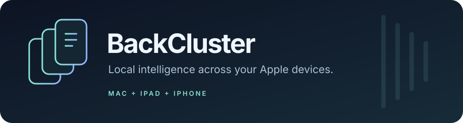

<p align="center">
  
</p>

<p align="center">
  <a href="https://github.com/art9762/backcluster/actions/workflows/diagnostics.yml"></a>
  <a href="docs/backcluster/ROADMAP.md"></a>
  <a href="LICENSE"></a>
</p>

**BackCluster — локальный inference-стек для Mac, iPad и iPhone.** Цель — запускать Qwen3.8-27B для coding workflow, распределяя вычисления и память между Apple-устройствами и сохраняя на Mac место для редактора и сборок.

Основа — [backburner](https://github.com/StayLameBro/backburner) и закреплённый `llama.cpp`. Целевая связка: **MacBook Pro M4 Pro / 24 ГБ · iPad Pro 13 M5 · iPhone 17 Pro Max**. Память устройств измеряется отдельно; физические 48 ГБ не являются общей оперативной памятью.

### Что работает сейчас

| Возможность | Состояние |
| --- | --- |
| CLI diagnostics, model/shard/partition, plan/serve, quality/bench/compare, OpenCode config | Реализовано, есть автоматические проверки |
| Проверка GGUF, SHA-256, engine pin и template identity | Реализовано, без загрузки весов целиком в RAM |
| Явный registry устройств и отдельные оценки памяти | Реализовано; план показывает блокеры |
| Mac-only OpenAI-compatible endpoint | Реализован запуск; inference на целевом Mac требует проверки |
| iPhone/iPad worker, кабель и шифрованный Wi-Fi tunnel | Сохранён upstream runtime; BackCluster app собирается в CI |
| Парный split-prefill/decode и один/два remote-KV workers | Явный launcher с live identity/routes/memory checks; нужны замеры на устройствах |
| Три вычислительные стадии Mac → middle → tail | Native downstream runtime; численная CPU-проверка, аппаратная приёмка ожидается |
| Atomic checkpoints и durable tool journal | Проверенный portable toolkit; интеграция с native OpenAI server остаётся отдельной работой |

**Следующий этап реализованных режимов — аппаратная приёмка.** Native CPU gate сравнивает обычный и трёхстадийный forward маленькой Qwen35, включая GDN/full attention, f32/f16 residual, greedy, append/reset и потерю workers. Он не подтверждает качество/скорость Qwen3.8-27B, Metal kernels или мобильный бюджет. Отчёты сохраняют `hardware_validated=false`, offline планы — `launch_ready=false`. [Матрица проверок и оставшихся работ](docs/backcluster/SOFTWARE_ACCEPTANCE.md).

### Быстрый старт

Для сборки и inference нужен Apple Silicon Mac, Python 3.9+, CMake, Xcode 26+ и Metal toolchain. Offline-проверки форматов и Python-тесты работают также на Linux.

```bash
git clone --recurse-submodules https://github.com/art9762/backcluster.git
cd backcluster
./backcluster doctor --human
./backcluster build
IPA=1 scripts/build-backcluster.sh
```

`doctor --human` показывает, что исправить; без `--human` выводит JSON. `BackCluster.ipa` появится в `ios/build/`. Подпись и установка описаны в [пошаговом руководстве](docs/backcluster/PRE_HARDWARE.md).

Опционально установи команду из текущего checkout:

```bash
./install.sh
backcluster --help
```

Установщик создаёт ссылку на CLI в `~/.local/bin`; checkout нужно сохранить, а каталог добавить в `PATH`. Сборка (`./install.sh --build`), скачивание модели и подпись — отдельные действия. Обновление: `git pull --ff-only`, затем `git submodule update --init --recursive`.

### Первый локальный запуск

Скачай выбранный GGUF по закреплённой revision и задай локально `MODEL`, `MODEL_REPOSITORY`, `MODEL_REVISION`. Revision — полный 40-символьный commit publisher, путь — к полному unsplit GGUF.

```bash
./backcluster model --file "$MODEL" --repository "$MODEL_REPOSITORY" \
  --revision "$MODEL_REVISION" --output .backcluster/model-lock.json
./backcluster serve --lock .backcluster/model-lock.json --file "$MODEL" \
  --context 16384 --output .backcluster/launch.json
```

Endpoint: **`http://127.0.0.1:8080/v1`**. Model alias: `backcluster-<первые 16 символов SHA-256>`, также записан в launch receipt. Сервер запускает одну сессию с q8 KV, без drafter и remote workers. `serve --dry-run` проверяет файл и показывает команду без запуска. CLI не меняет `sysctl` и не включает облачный fallback.

Во втором терминале:

```bash
./backcluster quality --lock .backcluster/model-lock.json --launch .backcluster/launch.json \
  --tokens 512 --output .backcluster/mac-quality.json
./backcluster bench --lock .backcluster/model-lock.json --launch .backcluster/launch.json --prompt bench/prompt.txt \
  --repeats 5 --tokens 256 --output .backcluster/baseline-16k.json
```

Далее — [профили, payload-тесты и сравнение пар](docs/backcluster/PRE_HARDWARE.md). [`registry.example.json`](profiles/registry.example.json) нужно заполнить измерениями. [`apple-trio.example.json`](profiles/apple-trio.example.json) описывает будущую конфигурацию; runtime её не читает.

### Документация

| Документ | Содержание |
| --- | --- |
| [Подготовка к устройствам](docs/backcluster/PRE_HARDWARE.md) | Сборка, установка, фиксация модели, первые замеры |
| [Диагностика](docs/backcluster/DIAGNOSTICS.md) | Форматы, ограничения и exit codes |
| [Восстановление tool result](docs/backcluster/TOOL_RECOVERY.md) | Проверка и фиксация результата после crash без повторного side effect |
| [Архитектура](docs/backcluster/ARCHITECTURE.md) | Роли, режимы, state и восстановление |
| [Модель и память](docs/backcluster/MODEL_AND_MEMORY.md) | Квантизации и отдельные бюджеты |
| [Roadmap](docs/backcluster/ROADMAP.md) · [Backlog](docs/backcluster/BACKLOG.md) | Этапы и критерии готовности |
| [Точка продолжения](docs/backcluster/NEXT_SESSION.md) | Что проверять дальше |
| [Upstream guide](README.upstream.md) · [Происхождение](UPSTREAM.md) | Оригинальные сценарии и закреплённые исходники |

### Разработка

```bash
scripts/install-hooks.sh
scripts/check.sh
scripts/test-native-pipeline.sh
# На Mac: дополнительно Apple security suite
tests/security/run.sh
```

[Правила разработки](CONTRIBUTING.md) · [Безопасность](SECURITY.md) · [Изменения](CHANGELOG.md). Модели, registry, reports и подпись не коммитятся; диагностику сохраняй в `.backcluster/`. Исторические цифры в `bench/results/` принадлежат upstream.

MIT © авторы [backburner](https://github.com/StayLameBro/backburner) и участники BackCluster. Лицензия весов определяется их publisher.
