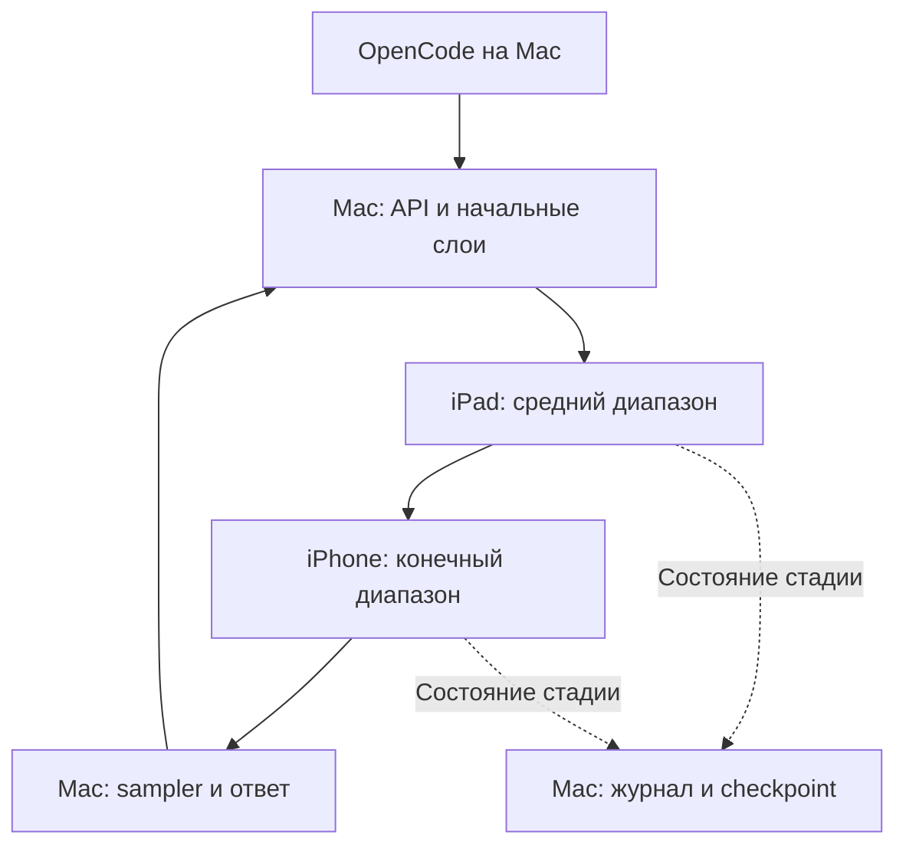

# Архитектура BackCluster

Статус: частично реализовано в 0.4. Native pair/three-stage compute и явный remote-KV launcher имеют программные gates; целевая Apple связка не проверена. Разделы о weighted KV, combined offload и production distributed checkpoints описывают последующую работу. Основание — [аудит](AUDIT.md); актуальная матрица — [SOFTWARE_ACCEPTANCE.md](SOFTWARE_ACCEPTANCE.md).

## Роли и физическая топология

Mac — координатор, OpenAI-compatible API, tokenizer, sampler, журнал сессии, файлы проекта и выполнение инструментов OpenCode. iPad и iPhone — native workers. Исходники проекта и shell-команды не отправляются на них для исполнения; workers считают тензоры модели.

Оба мобильных устройства подключены отдельными кабелями к Mac. Логическая цепочка вычислений может проходить через iPad и iPhone, но transport между ними в первой версии ретранслирует Mac. Прямой peer-to-peer не требуется.

## Режим A: accelerator

Полная Qwen3.8 IQ4_XS остаётся на Mac, плюс опциональный совместимый drafter. На iPad находится копия хвоста модели. Начальная гипотеза — iPad как основной prefill-worker, iPhone как KV-worker; назначение подтверждается измерением, а не названием чипа.

| Состояние | Mac | iPad | iPhone |
|---|---|---|---|
| Короткий запрос | Полный forward/decode | Может простаивать | Может простаивать |
| Большой prefill в локальном окне | Начальные слои, pipeline | Tail, mirror своего состояния | Необязателен |
| Decode в локальном окне | Полная модель и drafter | Не нужен на критическом пути | Не нужен на критическом пути |
| Контекст выходит за локальное окно | Полная модель, merge attention | Remote KV по выбранному плану | Remote KV по выбранному плану |

Последняя строка использует существующее ограничение upstream: split-prefill выключен, пока tail не умеет обращаться к remote KV. Совместить два вида offload — BC-025, а не предположение первого релиза.

Плюс режима A — короткий путь к полезной системе с сохранением Mac-only fallback для ускоряющего worker. Минус — память Mac под основные веса не освобождается. Реплики на workers нельзя считать дополнительной уникальной ёмкостью весов.

## Режим B: capacity

Веса, KV и recurrent state разделяются между устройствами по непрерывным диапазонам слоёв. Сначала два узла Mac + iPad на существующем split-decode; затем три узла. Модель может использовать более точную квантизацию или оставить больше RAM на Mac для разработки.

Предлагаемая логическая схема трёх стадий:

Стрелка iPad -> iPhone обозначает порядок вычислений; физическая передача идёт iPad -> Mac -> iPhone. Роли iPad/iPhone можно поменять после профилирования. Границы `[0,L1)`, `[L1,L2)`, `[L2,64)` выбираются с учётом GGUF metadata; сначала кратны full-attention interval. MTP-блок не входит в 64 trunk-слоя.

Для первого двухузлового режима сохраняем output head на tail, как upstream. Для трёх стадий измеряем два варианта: tail возвращает logits или residual возвращается на Mac, где находятся output norm/head. Второй вариант экономит трафик, но требует памяти под head и корректной реализации. Нельзя удалить output head со всех узлов ради красивого бюджета.

**Один decode-токен проходит стадии последовательно.** Pipeline увеличивает throughput крупных prefills, но не делает latency одного autoregressive токена равной самой быстрой стадии. Поэтому capacity-mode может быть медленнее accelerator-mode и всё равно полезен по памяти/качеству.

## Planner

Сначала статический план на запуск сессии; live migration не входит в MVP. Входы: identity модели и сборки, bytes каждого тензора, budgets, RTT, пропускная способность payload, время слоёв для prefill/decode, thermal state, целевой context, reserve Mac под IDE/сборку.

Целевые функции различаются:

- Prefill: приблизительно `fill + (microbatches - 1) * max(stage_time) + drain + sync`; окончательное решение по end-to-end замеру.
- Decode: сумма времени стадий, связей и sampling на один токен. Speculative mode оценивается по принятому токену, а не draft-token/s.
- Capacity: уложить каждый узел в бюджет с reserve, затем минимизировать задержку.

Допускается исключать iPhone из критического пути. Распределение поровну по памяти или числу слоёв не является корректным автоматическим решением.

## Контракты управления

Registry хранит псевдонимы узлов, интерфейс/transport, capability set и последний успешный probe. Личные UDID/IP остаются в локальном некоммитящемся конфиге.

Целевой полный handshake проверяет:

- protocol/state versions, engine commit/build ID;
- model hash, tokenizer/template identity, shard range и hash;
- global layer map, dtype, KV format, context allocation, recurrent state layout;
- session ID, topology epoch, sequence ID и обработанную позицию;
- reserve и доступные байты после загрузки, поддержку middle-stage/remote-KV/rollback.

Chunk имеет sequence number, диапазон token positions, размер/dtype, bounded payload и deadline. Повторная доставка не должна повторно продвигать recurrent state: либо idempotency на commit boundary, либо откат к согласованному checkpoint с новым epoch.

Уже существующий wire format не расширяем неявно. Новые возможности согласуются через version/capabilities; несовместимое устройство отклоняется до генерации. Копии `phone-attn.h` в parent и engine должны совпадать.

## Состояние, отмена и отказы

| Событие | Корректная реакция |
|---|---|
| Accelerator потерян до remote-KV eviction | Откатить незавершённый batch и повторить на Mac, если полное состояние доступно |
| Потерян владелец уникального KV | Завершить запрос понятной ошибкой; восстановить из полного checkpoint или сделать re-prefill из журнала |
| Потерян владелец части весов | Не обещать Mac-only продолжение; дождаться worker либо создать новый план, который действительно помещается |
| Отмена генерации клиентом | Остановить все стадии, отбросить speculative/uncommitted state, подтвердить общую позицию |
| Нагрев или memory warning | Ограничить следующий batch; при необходимости сохранить согласованную сессию и перепланировать её между запросами |
| Изменились модель, KV dtype или topology | Инвалидировать несовместимый cache; не загружать частичное состояние как полное |

Транскрипт и результаты выполненных инструментов хранятся на Mac. Восстановление инференса не должно повторно выполнять shell-команды или применять уже применённый patch. Checkpoint включает все KV shards, GDN/recurrent state и sampler RNG; manifest становится видимым только после успешного сохранения всех частей.

На первом capacity-прототипе speculation/drafter отключены. Их включение требует согласованного rollback GDN/KV на всех стадиях. Изменение порядка float-операций проверяется отдельно; слово «lossless» не заменяет численной проверки.

## Границы MVP

Одна активная inference-сессия, текстовый coding workflow, проводная связь, ручной выбор проверенного профиля. Не входят: обучение модели, vision offload, tensor-parallel all-reduce, expert paging, фоновый мобильный GPU как обязательное условие, Android/Windows, arbitrary hot-plug без восстановления.

CLI реализует model/shard/partition, diagnostics, estimates, Mac/pair/pipeline/remote-KV launch, quality/bench/compare и OpenCode config. Native SPT stage extension согласует source identity/ranges/dimensions/epoch/request IDs; control receipt дополнительно сверяет actual artifact hash и engine build ID. Compute-split и remote KV одновременно не включаются. Python BCTX реализует отдельный transactional/state contract с atomic checkpoints/journal; он не является подключённой заменой native SPT и не означает production persistence API. Native launcher выключает slot cache/checkpoints и требует re-prefill0 после потери state owner. См. [PRE_HARDWARE.md](PRE_HARDWARE.md).
