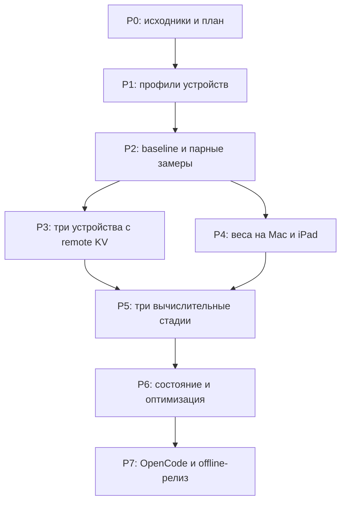

# План работ

План от 2026-10-09, цель Qwen3.8-27B. **Завершён только P0; остальные этапы запланированы.** Критерии ниже — требования BackCluster, а не измеренные результаты.

## Порядок

Первые интеграционные проверки OpenCode проводим уже в P2; P7 — полноценная приёмка. P3 и P4 независимы после baseline, но отсутствие железа не заменяем вымышленными результатами.

## P0 — подготовка, выполнено

Сохранены parent history, engine gitlink, оригинальный README и лицензия. Разобраны splitter, split client/tail protocol, remote KV, memory heuristics, mobile worker и benchmarks. Созданы архитектура, backlog и runbook. Изменений runtime нет. Публикация нового удалённого репозитория — отдельный проверяемый шаг, не следствие наличия этой отметки.

## P1 — оборудование и совместимость

Задачи BC-001–003. Фиксируем macOS/iOS/iPadOS, фактические CPU/GPU/RAM, Xcode/signing, app/Metal budgets, два кабельных интерфейса и модельные hashes. Проверяем iPad без debugger, возможность сокетов и фактическую полосу, не предполагаем Thunderbolt Bridge.

**Готово:** оба workers по отдельности обнаруживаются и выполняют короткий forward; identity и memory profile записаны без личных идентификаторов; модель/draft/shards воспроизводимо закреплены. **Стоп:** неизвестный бюджет или неверный shard запрещает запуск кластера. Оценка: 1–2 рабочих дня после доступа к устройствам, без учёта загрузки весов и проблем подписи.

## P2 — baseline, качество, парное ускорение

Задачи BC-004–006. Сравниваем stock engine при совместимости, pinned fork Mac-only, Mac+iPhone, Mac+iPad. Одинаковые веса, KV, prompt, sampling и context; drafter off/on отдельными сериями. Для базового M4 Pro подбираем SME отдельно, включая тест со сборкой проекта.

**Готово:** минимум пять парных повторов на 16k/32k и несколько репрезентативных coding-задач; TTFT, turn latency, decode, RAM/swap и thermal доступны в raw rows. Выбран fastest valid pair. Проверены SSE, tool call/response и одна правка файла через OpenCode.

**Граница:** если pair не выигрывает, выясняем link/memory/cache/thermal причину; не обещаем ускорение третьим узлом. Оценка: 2–4 дня.

## P3 — три устройства, разные роли и remote KV

Задачи BC-010–013. Создаём registry, независимые admission checks и statically selected layout. Сначала валидируем существующее равное распределение KV на двух настоящих workers; затем добавляем weighted allocation с корректным position mapping. На большой глубине split-prefill пока выключен.

**Готово:** сессия действительно использует KV обоих workers, проходит 64k и один из 96k/128k профилей в безопасных бюджетах; нет silent corruption; час нагрузки и controlled disconnect имеют записанный результат. На коротком контексте не требуем искусственно занимать iPhone.

**Стоп:** если третий узел ухудшает целевой сценарий, профиль остаётся экспериментальным, default использует лучшую пару. Это не закрывает P5 с распределёнными весами. Оценка: 3–7 дней.

## P4 — память Mac, веса на двух узлах

Задачи BC-020–021. Сначала используем существующий split-decode на Mac+iPad и IQ4_XS, затем пробуем Q5_K_M. Fork движка нужен перед его первым изменением. Ищем split по реальным tensor bytes, KV/state и времени стадий. Без speculation/checkpoints на первом прототипе.

**Готово:** подтверждено, что Mac не читает удалённые веса при decode; peak RAM Mac снизился минимум на 4 GiB на сопоставимом IQ4-профиле; ответ и tool loop корректны. Q5 считается отдельным результатом, только если проходит бюджет и quality gate.

**Стоп:** большие постоянные page-ins или неприемлемая latency — основание оставить capacity-profile экспериментальным. Целевой порог usability на 16k/32k: не менее 10 accepted tok/s и отсутствие устойчивого роста swap при обычной разработке; это ориентир для приёмки, не прогноз. Оценка: 3–7 дней.

## P5 — полноценная цепочка из трёх вычислительных стадий

Задачи BC-022–024. Добавляем middle-shard, передачу residual наружу, coordinator для двух workers, глобальные позиции и state sync. Сначала IQ4 без speculation и только локальные KV владельцев слоёв. Потом Q5/Q6 при достаточных бюджетах. Сравниваем output-head на tail и на Mac.

**Готово:** forward проходит Mac, iPad и iPhone; trace подтверждает уникальное владение каждым trunk-слоем, нет пропущенных/дублируемых диапазонов; длинные append и diverging prompt проходят correctness gate. Измерены prefill и decode, fill/drain, link/copy и state-sync расходы. Режим не называется ускорением, если даёт только выигрыш памяти.

**Граница:** последовательный decode может проиграть паре. Сохраняем измеренный capacity-mode, а default выбираем по реальной задаче. Оценка: 1–3 недели, наибольший технический риск.

## P6 — восстановление и оптимизация

Задачи BC-025–028. Полные distributed checkpoints, отмена, переподключение и re-prefill без повторного исполнения инструментов. Совместимость split-prefill с remote KV и distributed speculation — отдельные opt-in работы, только после устойчивого режима без них. Проверяем возможный ANE выигрыш по измерениям, не суммируем TOPS.

**Готово:** сохранение/восстановление даёт согласованное состояние всех стадий; cancel, обрыв кабеля, memory warning и background не приводят к бесконечному ожиданию или продолжению с неполным KV. Speculation допускается в default только при измеренном выигрыше и корректном rollback. Оценка: 1–2 недели; опциональные оптимизации могут уйти после первого релиза.

## P7 — продукт и offline-приёмка

Задачи BC-030–032. Версионированные CLI/profile/model-lock, iPad/iPhone UI, fork-safe installer, OpenCode provider для установленной версии, local-only diagnostics, понятные ошибки. Не добавляем dashboard/облако прежде полезного рабочего цикла.

**Готово:** после предварительной установки Wi-Fi/интернет выключены; OpenCode читает проект, меняет несколько файлов, запускает доступные локальные тесты и завершает задачу. Работают streaming, tools, cancellation и context exhaustion. Не менее 10 фиксированных coding-задач, 60 минут непрерывной сессии, сохранены результаты и ограничения. Оценка: 3–7 дней.

## Итоговая приёмка

- Качество не объявляется равным только по одному совпавшему ответу. Проверяем greedy regression и teacher-forced logits; расследуем каждое расхождение. Near-tie из-за float-порядка документируем отдельно; одинаковый quant сравниваем с одинаковым quant.
- Режим ускорения включаем по умолчанию при снижении median latency representative tool-turn минимум на 15% относительно pinned fork Mac-only и без ухудшения p95 более 10% на той же выборке. Это проектные пороги.
- Режим ёмкости принимаем за подтверждённое освобождение RAM или более точную модель, с явно указанной ценой latency.
- Нет зависания, silent state loss, незаявленного обращения к облачной модели или заявлений о несуществующих замерах.

Оценки — инженерный диапазон для одной рабочей ветки, не обещанный срок. Первые результаты P1/P2 могут изменить приоритеты, но не подменяют конечную цель распределённых весов.
